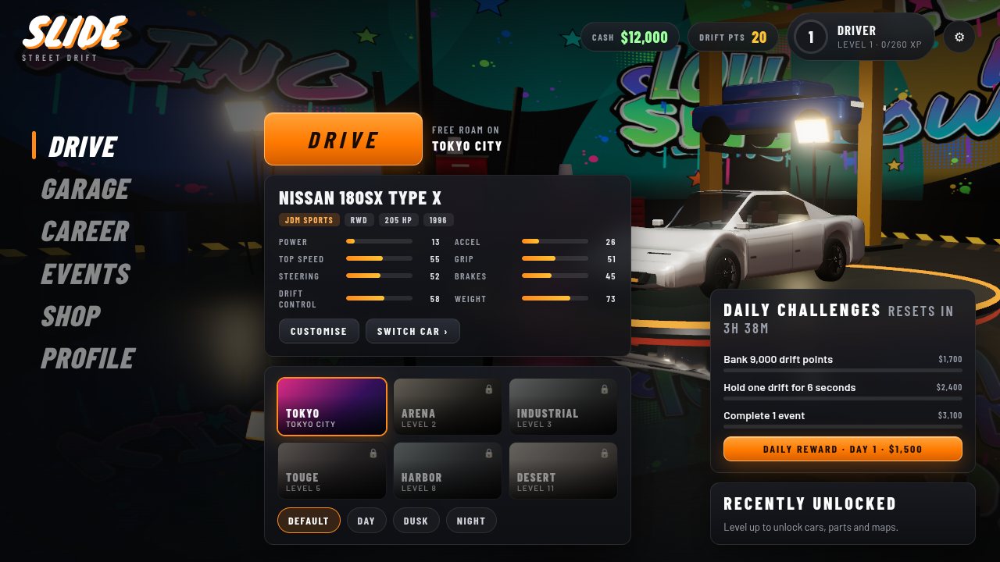
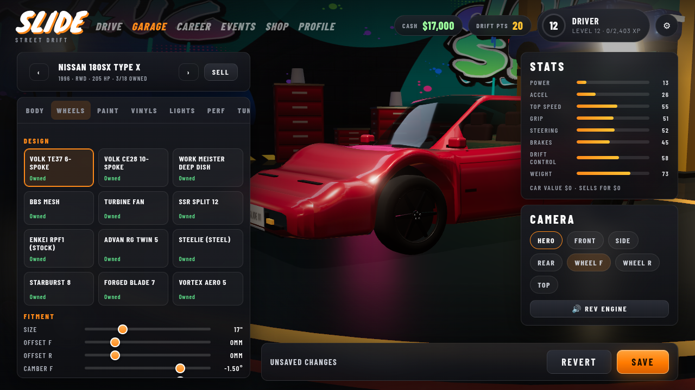
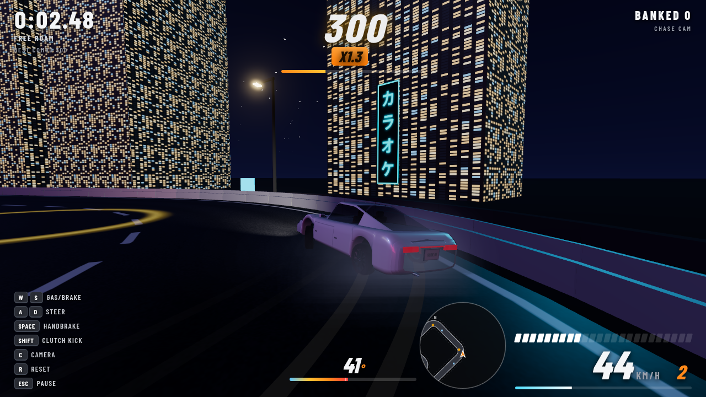
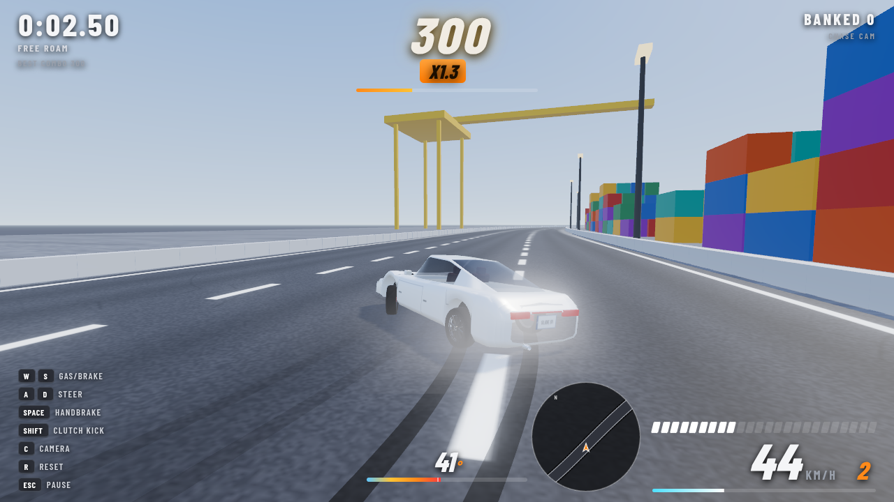

<p align="center"></p>

# SLIDE — Street Drift Racing

A premium Japanese-street drifting game for the desktop. 3D garage, deep car customisation, 6 maps, 12 cars, a 30-event career and a full drift-scoring system — all procedural, no downloads of art assets, runs in its own window.

## ⬇ Download (Windows)

**[Download SLIDE-Launcher-Setup.exe](https://github.com/piwadev/slide/releases/latest/download/SLIDE-Launcher-Setup.exe)** — or grab it from the [latest release](https://github.com/piwadev/slide/releases/latest).

Run the installer once (per-user, no admin rights, ~75 MB). It puts **SLIDE** on your desktop and Start menu. Press **Play**. From then on the launcher checks GitHub Releases on start and updates the game by itself (the game is only a ~1.5 MB download), exactly like the Kingdoms of War launcher. Your save lives in `%APPDATA%\Slide\saves` and is never touched by updates.

| | |
|---|---|
|  |  |
|  |  |

## Features

- **Driving** — arcade-sim drift physics: slip-angle tyres, friction ellipse, weight transfer, gearbox + RPM, turbo spool, clutch-kick, handbrake, counter-steer assist. Every car and every performance part changes the real handling. Keyboard + gamepad.
- **Scoring** — angle × speed × duration, long-drift tiers, near misses, clipping zones, corner chains, perfect combos, tandem proximity, multiplier. Crash or spin = combo lost.
- **Cars** — 18 cars (JDM, European, muscle, supercar, classic) with their own synthesized engine note, turbo/blow-off, tyre squeal.
- **Customisation** — body kits (bumpers, skirts, widebody, wings, hoods, fenders, mirrors), wheels (designs, size, colour, finish, offset, camber, width, tyres), paints (gloss/metallic/pearl/candy/satin/matte/chrome/colour-shift, two-tone), liveries + stickers + plate text, tint, headlight colour, underglow, exhaust flames, 9 performance categories, tuning sliders. Live 3D preview in a graffiti street garage.
- **Maps** — Tokyo City (traffic), Mountain Pass (touge), Industrial Zone, Harbor, Desert Highway, Drift Arena. Day / dusk / night, live mini-map.
- **Modes** — Free Roam, Drift Challenge, Time Attack, Tandem Drift (AI lead car), Career (30 events, 6 tiers), local leaderboards + personal records, profile stats + achievements.
- **Progression** — cash, XP, Drift Points, levels 1–60, daily challenges + login rewards, versioned save with rotating backups.
- Tyre smoke, persistent skid marks, dynamic lights/shadows, bloom, low/medium/high quality.

## Controls

| Action | Keyboard | Gamepad |
|---|---|---|
| Gas / brake / reverse | `W` `S` | RT / LT |
| Steer | `A` `D` | Left stick |
| Handbrake | `Space` | A |
| Clutch kick | `Shift` | B |
| Camera (chase / far / hood / cockpit / orbit) | `C` | Y |
| Reset to road | `R` | Back |
| Pause | `Esc` | Start |
| Shift up/down (manual mode) | `E` `Q` | RB / LB |

## Admin console (owner only)

Press **Ctrl+Shift+F12** (or long-press the profile card in the menu for about a second) and enter the owner passphrase. It is verified in the app with PBKDF2-SHA256 against a salted hash — the passphrase is not stored anywhere in this repo. Commands: `help`, `money`, `dp`, `xp`, `level`, `unlockall`, `unlockcars`, `unlockparts`, `unlockmaps`, `maxcar`, `givecar`, `event`, `complete`, `drive`, `daily`, `debug`, `status`, `reset confirm`, `lock`.

## Run from source

```bash
python3 -m http.server 8080      # then open http://localhost:8080  (any static server works)
cd launcher && npm install && npm start      # the desktop launcher
```

## Publishing an update

```bash
# edit CHANGELOG.md first: the "## vX.Y.Z" section becomes the release notes shown in the launcher
scripts/release.sh patch                 # game-only update (zip + manifest.json + sha256 on GitHub Releases)
scripts/release.sh minor --launcher      # also builds + attaches a new SLIDE-Launcher-Setup.exe
```

How the updater works is described in [launcher/README.md](launcher/README.md).

## Tech

Vanilla ES modules + [three.js](https://threejs.org) (vendored, MIT), WebAudio synthesis, no build step. Desktop launcher: Electron + NSIS, GitHub Releases as the update feed. Fonts: Barlow, Barlow Condensed, Bangers, Knewave, Permanent Marker, Rubik Spray Paint (SIL OFL).
